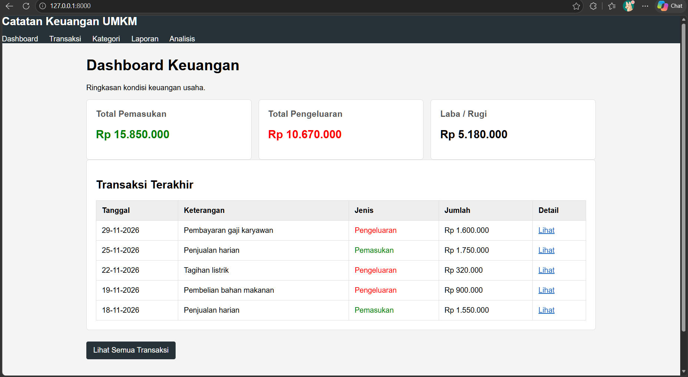
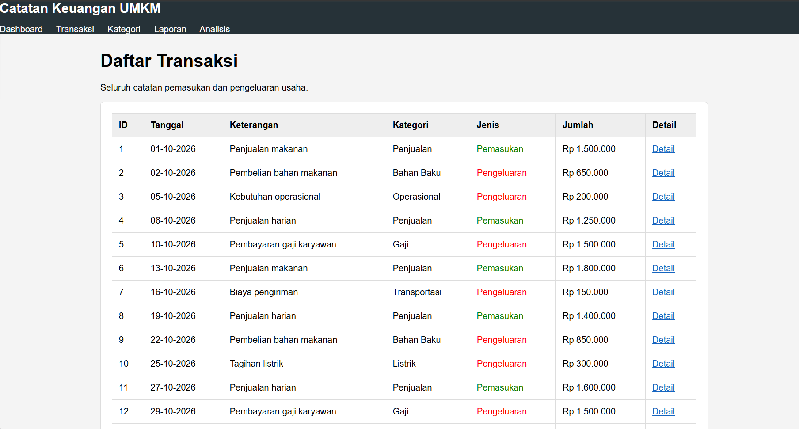
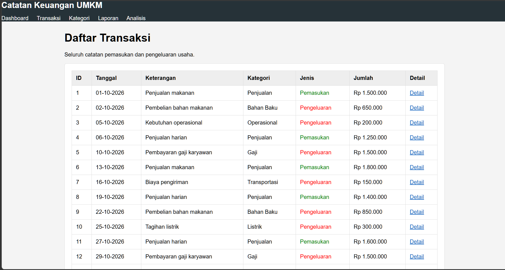
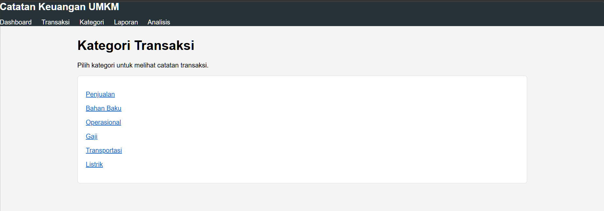
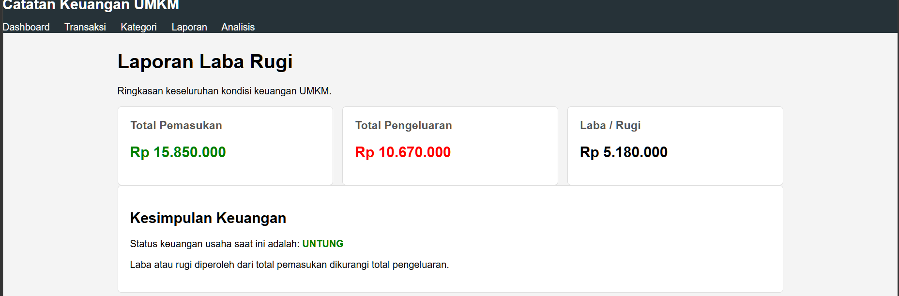
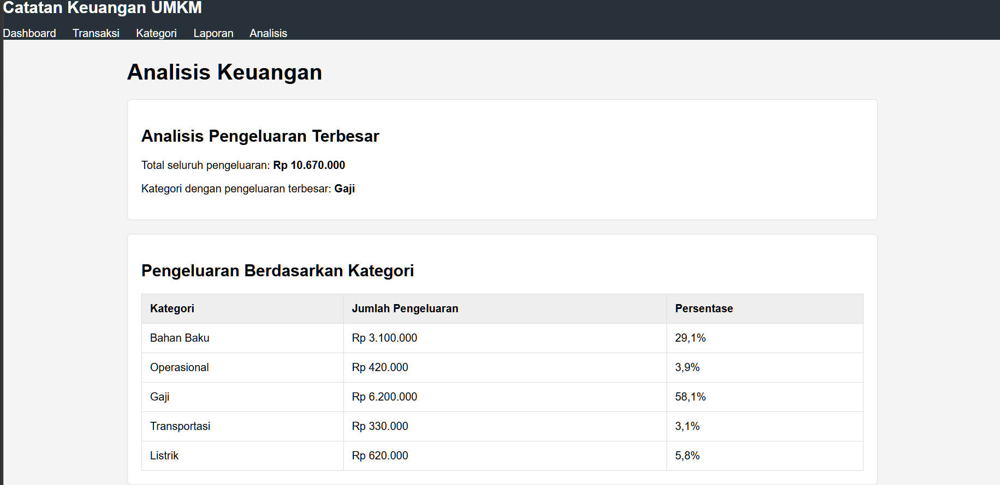
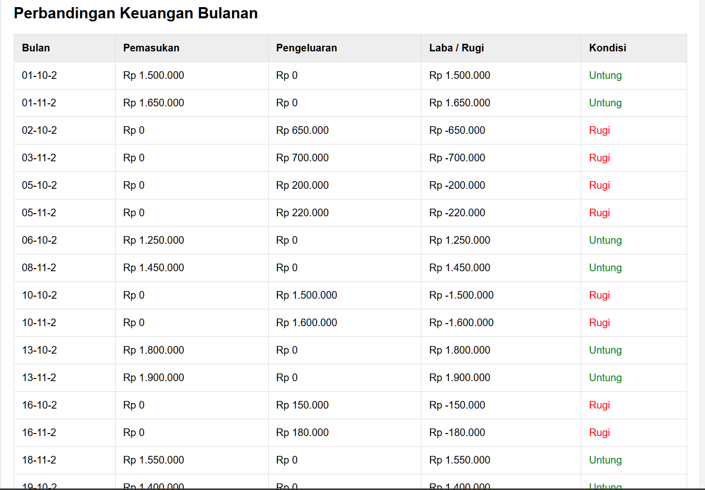
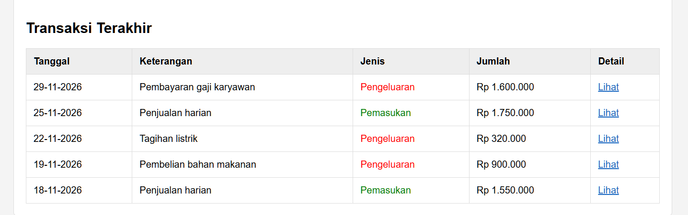

# Sistem Analisis Keuangan UMKM

## Identitas Mahasiswa

| Keterangan | Data |
|---|---|
| Nama | Raihan Doan |
| NIM | C2483207005 |
| Kelas | PTI5A |
| Tema Proyek | Tema 4 — Sistem Analisis Keuangan UMKM |

## Deskripsi Proyek

Sistem Analisis Keuangan UMKM merupakan aplikasi web sederhana yang dibuat menggunakan framework Laravel. Aplikasi ini dirancang untuk membantu pemilik usaha kecil dan menengah (UMKM) memahami kondisi keuangan usahanya melalui pencatatan dan analisis transaksi pemasukan serta pengeluaran.

Permasalahan yang diangkat adalah pemilik UMKM sering mengalami kesulitan dalam mengetahui jumlah pemasukan, jumlah pengeluaran, keuntungan atau kerugian, serta kategori pengeluaran yang paling besar. Pemilik usaha juga membutuhkan cara sederhana untuk membandingkan kondisi keuangan dari satu bulan ke bulan berikutnya.

Sebagai solusi, aplikasi ini menampilkan ringkasan keuangan, daftar dan detail transaksi, pengelompokan transaksi berdasarkan kategori atau periode, laporan laba-rugi, serta analisis pengeluaran dan perbandingan keuangan bulanan.

Data transaksi disimpan menggunakan array PHP di dalam file `config/transaksi.php`. Aplikasi ini tidak menggunakan database maupun autentikasi. Data yang digunakan merupakan data contoh untuk keperluan demonstrasi pengolahan keuangan UMKM.

## Fitur Aplikasi

1. **Dashboard** — menampilkan total pemasukan, total pengeluaran, laba atau rugi, dan transaksi terakhir.
2. **Daftar transaksi** — menampilkan seluruh data transaksi beserta tanggal, keterangan, kategori, jenis, dan jumlah transaksi.
3. **Detail transaksi** — menampilkan informasi satu transaksi berdasarkan ID.
4. **Kategori transaksi** — menampilkan daftar kategori dan transaksi berdasarkan kategori yang dipilih.
5. **Filter periode** — menampilkan transaksi berdasarkan bulan.
6. **Laporan laba-rugi** — menghitung total pemasukan, total pengeluaran, dan hasil laba atau rugi.
7. **Analisis keuangan** — menampilkan jumlah serta persentase pengeluaran per kategori, kategori pengeluaran terbesar, dan perbandingan keuangan bulanan.

## Implementasi Routing, Controller, dan Blade View

Aplikasi menerapkan pola Model–View–Controller (MVC) melalui Routing, Controller, dan Blade View Laravel. Karena data disimpan dalam array PHP dan tidak menggunakan database, pengambilan data dilakukan melalui file konfigurasi `config/transaksi.php`.

### 1. Routing

Routing didefinisikan di dalam `routes/web.php`. Setiap route menghubungkan URL dengan method pada controller yang sesuai. Aplikasi memiliki delapan route utama:

| URL | Controller dan method | Fungsi |
|---|---|---|
| `/` | `DashboardController@index` | Menampilkan dashboard keuangan. |
| `/transaksi` | `TransactionController@index` | Menampilkan seluruh transaksi. |
| `/transaksi/{id}` | `TransactionController@show` | Menampilkan detail transaksi berdasarkan ID. |
| `/kategori` | `TransactionController@categories` | Menampilkan daftar kategori transaksi. |
| `/kategori/{nama}` | `TransactionController@byCategory` | Menampilkan transaksi berdasarkan nama kategori. |
| `/periode/{bulan}` | `TransactionController@byMonth` | Menampilkan transaksi berdasarkan periode bulan. |
| `/laporan` | `ReportController@index` | Menampilkan laporan laba-rugi. |
| `/analisis` | `ReportController@analysis` | Menampilkan analisis pengeluaran dan perbandingan bulanan. |

Parameter URL `{id}`, `{nama}`, dan `{bulan}` digunakan untuk memilih data yang akan ditampilkan. Contohnya, `/transaksi/5` menampilkan transaksi dengan ID 5, sedangkan `/periode/2026-10` menampilkan transaksi pada Oktober 2026.

### 2. Controller

Logika pengolahan data dan perhitungan ditempatkan di dalam tiga controller:

- **`DashboardController`** mengambil data transaksi, menghitung total pemasukan dan pengeluaran, menghitung laba atau rugi, serta memilih lima transaksi terakhir.
- **`TransactionController`** menangani daftar transaksi, pencarian detail berdasarkan ID, penyusunan daftar kategori, dan penyaringan transaksi berdasarkan kategori maupun bulan.
- **`ReportController`** menghitung laporan laba-rugi, mengelompokkan pengeluaran berdasarkan kategori, menghitung persentase pengeluaran, mencari kategori pengeluaran terbesar, dan membandingkan kondisi keuangan setiap bulan.

Dengan demikian, proses perhitungan dilakukan di Controller, sedangkan Blade View bertugas menampilkan hasilnya.

### 3. Blade View

Halaman aplikasi dibuat menggunakan Blade Template Laravel dan HTML, dengan CSS sederhana untuk mengatur tampilan. Blade View menggunakan `@extends`, `@section`, dan `@yield` agar halaman menggunakan layout yang sama. Perulangan data menggunakan `@foreach`, sedangkan percabangan tampilan menggunakan `@if`, `@elseif`, dan `@else`.

Layout utama berada di `resources/views/layouts/app.blade.php`. Halaman lainnya berada di folder `resources/views`, yaitu halaman dashboard, transaksi, kategori, periode, dan laporan.

## Logika Perhitungan dan Analisis

Seluruh perhitungan dilakukan menggunakan PHP pada Controller berdasarkan data di `config/transaksi.php`.

### 1. Total Pemasukan dan Pengeluaran

Program memeriksa nilai `jenis` pada setiap transaksi. Jika jenis transaksi adalah `pemasukan`, jumlah transaksi ditambahkan ke total pemasukan. Jika jenisnya `pengeluaran`, jumlah transaksi ditambahkan ke total pengeluaran.

### 2. Laba atau Rugi

Laba atau rugi dihitung menggunakan rumus:

```text
Laba/Rugi = Total Pemasukan - Total Pengeluaran
```

Hasil perhitungan ditafsirkan sebagai berikut:

- Hasil lebih dari 0: usaha memperoleh **laba**.
- Hasil kurang dari 0: usaha mengalami **rugi**.
- Hasil sama dengan 0: kondisi keuangan **impas**.

### 3. Pengelompokan Pengeluaran Berdasarkan Kategori

Program memeriksa transaksi yang berjenis pengeluaran, kemudian menjumlahkan nominalnya berdasarkan kategori. Dengan cara ini, total pengeluaran untuk setiap kategori dapat diketahui.

### 4. Persentase Pengeluaran

Persentase setiap kategori dihitung menggunakan rumus:

```text
Persentase Kategori = (Pengeluaran Kategori / Total Pengeluaran) x 100%
```

Program memeriksa terlebih dahulu apakah total pengeluaran lebih besar dari nol. Jika total pengeluaran sama dengan nol, persentase ditetapkan menjadi 0 agar tidak terjadi pembagian dengan nol.

### 5. Kategori Pengeluaran Terbesar

Program mengurutkan jumlah pengeluaran setiap kategori dari nilai terbesar. Kategori pada urutan pertama ditampilkan sebagai kategori pengeluaran terbesar. Jika belum terdapat data pengeluaran, aplikasi menampilkan keterangan bahwa belum ada pengeluaran.

### 6. Perbandingan Keuangan Bulanan

Bulan transaksi diambil dari bagian tahun dan bulan pada tanggal transaksi (`YYYY-MM`). Pemasukan dan pengeluaran kemudian dijumlahkan untuk setiap bulan. Laba atau rugi bulanan dihitung dengan mengurangi total pengeluaran bulanan dari total pemasukan bulanan.

## Dokumentasi Tampilan Aplikasi

> Letakkan seluruh file gambar berikut di folder yang sama dengan `README.md`. Nama file harus sama dengan yang tercantum di bawah agar gambar tampil langsung di GitHub.

### Dashboard



### Daftar Transaksi





### Kategori Transaksi



### Laporan Laba-Rugi



### Analisis Keuangan





### Transaksi Terakhir



## Petunjuk Menjalankan Aplikasi

### Persyaratan

- PHP yang sesuai dengan versi Laravel pada proyek.
- Composer.
- Laravel.
- Web browser.

### Langkah Menjalankan

1. Clone repository atau buka folder proyek Laravel.
2. Buka terminal pada folder proyek.
3. Install dependency Laravel dengan perintah:

   ```bash
   composer install
   ```

4. Buat file `.env` dari file contoh. Pada Windows PowerShell, jalankan:

   ```powershell
   Copy-Item .env.example .env
   ```

   Pada Linux atau macOS, jalankan:

   ```bash
   cp .env.example .env
   ```

5. Buat application key:

   ```bash
   php artisan key:generate
   ```

6. Buka file `.env`, kemudian pastikan penyimpanan session dan cache menggunakan file:

   ```env
   SESSION_DRIVER=file
   CACHE_STORE=file
   QUEUE_CONNECTION=sync
   ```

7. Bersihkan cache konfigurasi Laravel:

   ```bash
   php artisan optimize:clear
   ```

8. Jalankan server Laravel:

   ```bash
   php artisan serve
   ```

9. Buka alamat berikut di browser:

   ```text
   http://127.0.0.1:8000
   ```

**Catatan:** Aplikasi menggunakan array PHP pada `config/transaksi.php` sebagai sumber data transaksi. Oleh karena itu, aplikasi ini tidak memerlukan database dan tidak perlu menjalankan perintah migrasi seperti `php artisan migrate`.

## Teknologi yang Digunakan

- PHP
- Laravel
- Blade Template
- HTML
- CSS

---

Proyek ini dibuat untuk memenuhi tugas Project Based Learning mata kuliah dengan tema **Sistem Analisis Keuangan UMKM**.
